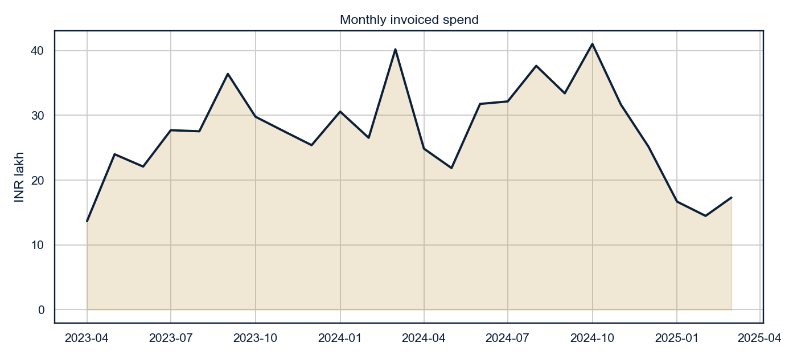
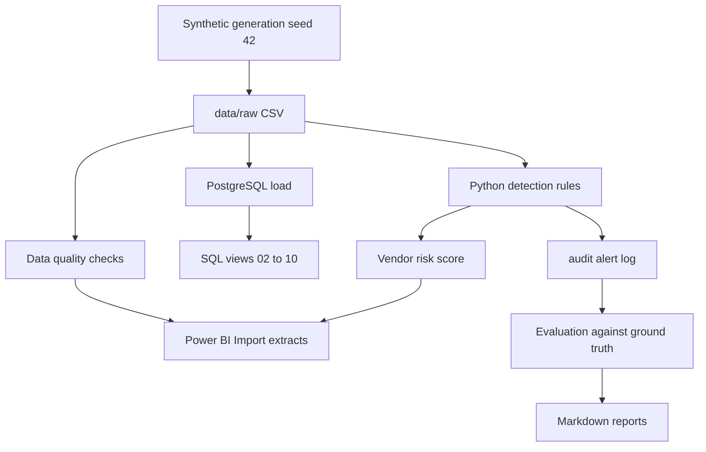
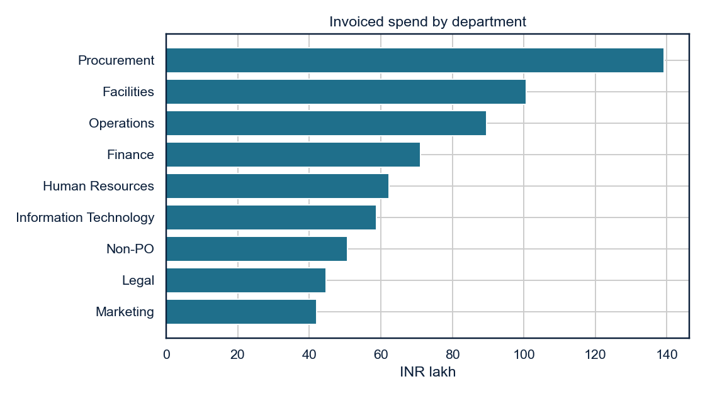
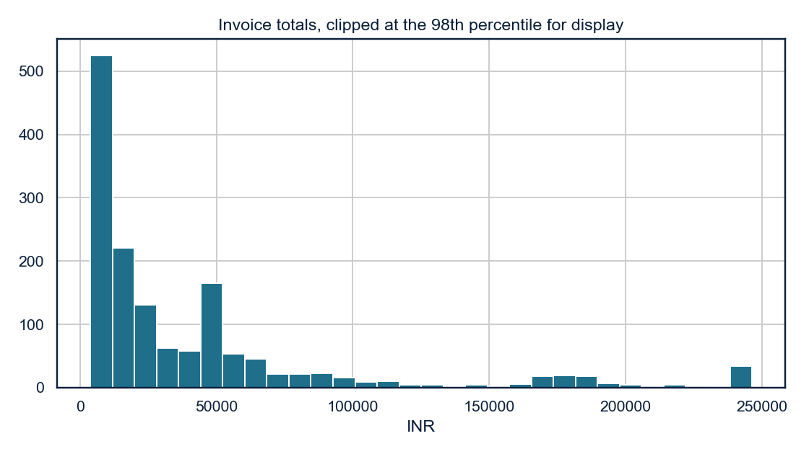
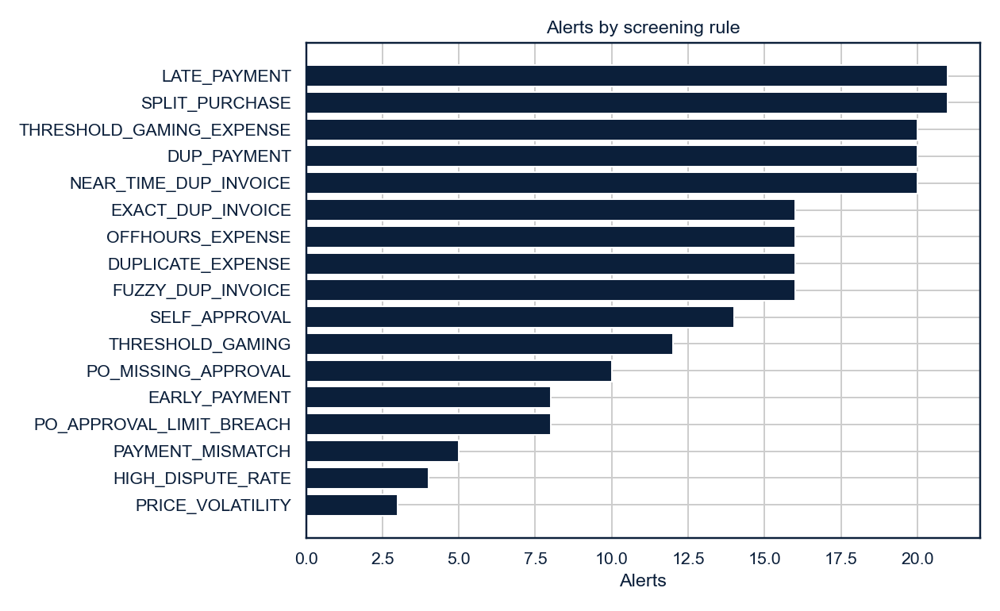
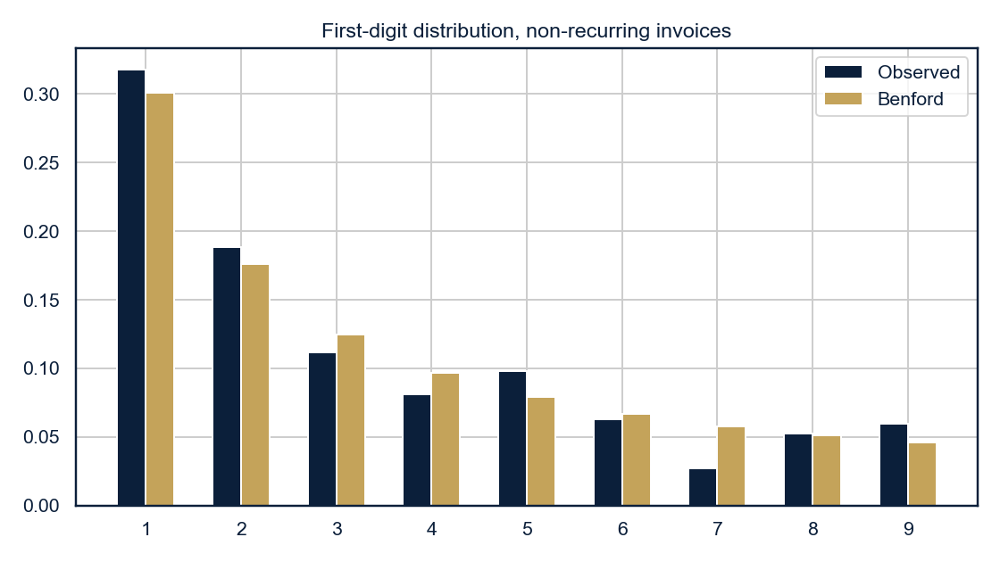
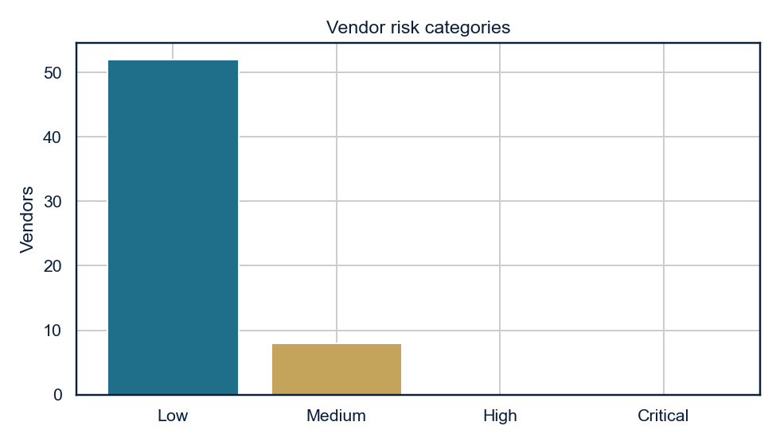
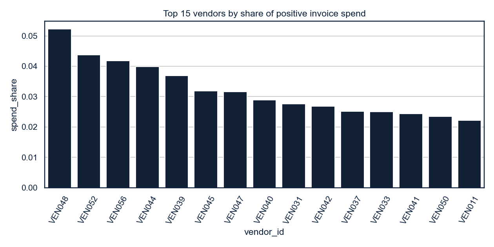

# ProcureGuard — Procurement Fraud Detection & Vendor Risk Analytics Platform

ProcureGuard is a reproducible analytics project for procurement screening and vendor-risk review. It builds a synthetic INR purchase-to-pay book, checks the file before anything is deleted, loads a normalised PostgreSQL schema, runs SQL and Python screens, scores vendors with an explainable weighted index, and prepares an Import-mode model for Power BI.

The records are synthetic. An alert is a candidate for review. Nothing in this repository is a confirmed fraud, a real vendor, or a real financial loss.

## Project overview

The chart below is the monthly invoiced spend from the seed-42 analysis run. The vertical axis is INR lakh. It is a matplotlib export from the pipeline, not a Power BI page and not a web-app screenshot.



## Business problem

Procurement and employee-expense processes leak money through duplicate bills, split orders that stay under an approval limit, payments that do not match the invoice, and vendors whose prices or disputes sit outside the rest of the category. An audit analytics team needs a worklist that names the rule, the records, and the rupee exposure, and that can be wrong in public: benign recurring invoices and properly approved splits have to survive the screen.

## Use cases

- Internal audit prepares a duplicate-invoice and duplicate-payment sample.
- A procurement controller reviews vendors whose orders cluster just below an approval threshold.
- Finance reconciles purchase orders, invoices, and payments and ages what is unpaid.
- A data-quality review lists orphan keys, broken totals, and illegal statuses without dropping the raw file.
- A reviewer compares each rule with planted labels before anyone treats the score as operational.

## Architecture



The workflow is one pass over a synthetic book:

1. Generate the seven operational CSVs and, separately, the ground-truth label file.
2. Validate the raw files and keep every failed row.
3. Screen invoices, purchase orders, payments, expenses, and approvals with the Python rules. The same rules are also written as PostgreSQL views.
4. Score each vendor from seven weighted rates and write an alert log with status Pending Review.
5. Compare alerts with the label file only after detection has finished.
6. Export tables and the charts in this README. Power BI is a written Import-mode specification. This repository does not contain a PBIX file or a web application.

Python is the path that the tests and the evaluation report use. The SQL scripts are the same rules expressed for an analyst working in the database. Where the grain or the loaded population differs, `reports/postgres_verification.md` records the difference.

Ground-truth labels are written only to `data/evaluation/`. The detection, scoring, and quality modules do not read that file. Evaluation runs after detection.

## Technology stack

Verified in this workspace:

- Python 3.12.1
- pandas 2.3.1, NumPy 2.2.3, Faker 40.44.0
- SQLAlchemy 2.1.6, psycopg2-binary 2.9.9
- SciPy 1.15.2, scikit-learn 1.6.1
- matplotlib 3.10.0, seaborn 0.13.2
- pytest 9.1.1, PyYAML 6.0.2, Jupyter tools listed in `requirements.txt`
- PostgreSQL 18.3 for the load described below

Power BI Desktop is specified in `dashboard/`. A PBIX file was not created or opened.

## Database schema

`database/01_schema.sql` creates tables if they are missing. It does not drop or truncate them.

| Table | Grain |
| --- | --- |
| employees | One employee. Manager key is deferrable. |
| vendors | One vendor. |
| purchase_orders | One order. |
| invoices | One invoice. Purchase order is optional. Amounts may be negative so defect rows can load. |
| payments | One payment. Invoice key is required, so orphan payments reject. |
| employee_expenses | One claim. |
| approval_records | One decision. The target is polymorphic, so the foreign key is checked in SQL and Python rather than as a single constraint. |
| audit_alerts_log | One screening alert. |
| risk_weight_config | One row per factor. Inserted only when the table is empty. |

Status checks accept the operational categories only. Planted values such as `On Leave` and `UNKNOWN` stay in the CSV and are logged as ingestion rejections. Indexes cover vendor-date, split keys, invoice number, payments, expenses, approvals, and alerts. Fuzzy matching uses `procureguard_levenshtein` in `database/03_duplicate_invoice_detection.sql`. `pg_trgm` is optional and is not required.

## Dataset

Seed 42, Indian rupees, 1 April 2023 to 31 March 2025. The dictionary is `data/README.md`. The generation write-up is `reports/generation_summary.md`.

| File | Rows |
| --- | ---: |
| employees.csv | 120 |
| vendors.csv | 60 |
| purchase_orders.csv | 850 |
| invoices.csv | 1,500 |
| payments.csv | 1,400 |
| employee_expenses.csv | 900 |
| approval_records.csv | 1,785 |
| ground_truth_labels.csv | 765 |

The book contains exact, near-time, and fuzzy invoice duplicates, split orders, threshold gaming, duplicate and mismatched payments, expense lookalikes, self-approval, price volatility, disputes, delayed payments, and data-quality defects. It also contains recurring invoices, repeated amounts, high-volume vendors, and splits that a director can approve. Eight near-time duplicates use the next serial number and are planted so the sequential-number exclusion misses them.

## SQL analytics

| Script | Contents |
| --- | --- |
| `01_schema.sql` | Tables, keys, checks, indexes, weight seed |
| `02_data_quality_checks.sql` | Nulls, duplicate bank hashes, negative amounts, date order, math gaps, polymorphic orphans |
| `03_duplicate_invoice_detection.sql` | Exact, normalised, and one-edit invoice numbers |
| `04_split_purchase_detection.sql` | 14-day islands and the 90-day near-threshold band |
| `05_vendor_risk_scoring.sql` | Factor rates and the weighted score |
| `06_expense_anomaly_detection.sql` | Duplicate claims, threshold gaming, off-hours, self-approval |
| `07_benford_analysis.sql` | First digits, MAD, chi-square statistic |
| `08_payment_analysis.sql` | Duplicate, early, late, and mismatched payments, aged to 31 March 2025 |
| `09_vendor_concentration.sql` | Pareto, category HHI, department-month spend |
| `10_fraud_risk_master_view.sql` | Score, category, and alert rollup |

On the verified load, exact duplicates, split dispositions, threshold gaming, off-hours claims, self-approvals, and the four payment rules matched the Python alert counts. Fuzzy and near-time SQL views return pairs (8 and 10) where Python returns the member invoices (16 and 20).

## Python methodology

`src/pipeline.py analyze` reads the raw CSVs and writes `data/processed/`.

Exploratory outputs cover monthly spend, department spend, invoice-amount distribution, missingness, and a correlation of the risk-factor rates. The same PNG files are written to `reports/figures/` and `screenshots/`. They are matplotlib and seaborn charts from the pipeline. They are not Power BI screenshots.

## Exploratory data analysis

Department totals attribute each invoice to the purchase-order department. Invoices without a purchase order are grouped as Non-PO.



The histogram clips the display at the 98th percentile so the body of the distribution stays readable. The underlying file still holds the larger invoices.



Statistical screens, applied inside vendor category when a group has at least 30 invoices:

- z-score, cutoff 3
- Tukey IQR, multiplier 1.5
- modified z-score using MAD, cutoff 3.5

The seed-42 run wrote 250 outlier rows. They are review aids. They are not alerts. Isolation Forest (`contamination` 0.1, seed 42) flagged 6 vendors as an unsupervised comparison. Those flags are not added to the 0–100 score.

Benford's Law is applied to invoice totals of at least INR 1,000, excluding recurring `-REC` items, petty `PTC-` codes, and `UNKNOWN` statuses, and only when the sample exceeds 100. The seed-42 invoice screen: n = 875, chi-square p = 0.000720, MAD = 0.014080, band `marginal_conformity`. Employee expenses are a capped contrast population: MAD = 0.018994, band `nonconformity`. A digit deviation is not evidence of fraud. The MAD bands follow the usual Nigrini-style heuristics.

## Procurement anomaly detection

Alert counts by rule come from the 230-row screening log. Each bar is a rule match on the synthetic book. It is not a count of confirmed fraud.



The Benford chart compares the first digits of the filtered invoice population with the expected shares. The expense population is omitted from this figure because those amounts are policy-capped.



## Vendor risk scoring

The score is the weighted sum of seven factors. Each factor is scaled from 0 to 100 against an anchor in `config/config.example.yaml`, then multiplied by its weight. The weights sum to 1.

| Factor | Weight | Anchor that scores 100 on the factor |
| --- | ---: | --- |
| Duplicate invoice rate | 0.22 | 15% of invoices |
| Dispute rate | 0.10 | 20% of invoices |
| Price volatility | 0.12 | coefficient of variation 0.50 |
| Split-purchase involvement | 0.18 | 25% of purchase orders |
| PO approval violations | 0.16 | 10% of purchase orders |
| Payment anomaly rate | 0.14 | 15% of payments |
| Spend concentration | 0.08 | share rising from 5% to 25% |

Categories: Low through 25, Medium through 50, High through 75, Critical above 75. A single factor cannot contribute more than its weight times 100, so a vendor that only splits orders can gain at most 18 points from that factor.

Seed-42 result: 60 vendors scored, 52 Low, 8 Medium, 0 High, 0 Critical. Highest score 34.38, vendor VEN044, Medium. The explanation column lists each factor's points and the observed rate. Supporting alert ids are stored on the score row. The weights are documented choices for a transparent demo. They are not fitted to reviewed cases.

## Vendor risk analysis

The category chart counts vendors after scoring. High and Critical are empty on this seed.



Spend share is separate from the risk score. The tallest bar is about 5% of positive invoice spend, so no vendor on this book reaches the concentration anchor by itself.



## Data quality results

`src/data_quality/validate.py` runs 30 checks on the raw files and writes the failures. It does not delete rows. Seed-42 pass rate: 15 of 30 checks passed, 50%. The failure file has 69 rows because a negative invoice is counted once per broken amount column (3 invoices, 4 columns, 12 rows) and because invoice-to-PO amount plants also break the tax identity.

The pipeline does not write a data-quality chart. The check list and the 69 failed-record rows are in `reports/data_quality_report.md` and `data/processed/data_quality_checks.csv`. No image is embedded here because that chart file does not exist.

Failed checks include math mismatches (13), negative invoice amounts (12 column-level rows), orphan purchase orders (6), out-of-range dates (6), invalid due dates (4), illegal invoice statuses (4), duplicate bank hashes (4), null emails (4), null vendor cities (3), orphan invoices (3), negative expenses (3), expenses before hire (3), duplicate invoice keys (2), one illegal vendor status, and one illegal employee status.

## Audit alerts

Each alert has an id, entity type and id, vendor or employee where the rule has one, rule code and name, severity, exposure, reason, JSON evidence, timestamp, and review status. New alerts are `Pending Review`. The other statuses (`Under Investigation`, `Reviewed — No Issue`, `Escalated for Investigation`) are reserved for a person. The pipeline does not mark anything confirmed.

Seed-42 alert log: 230 alerts. Sum of `estimated_exposure_inr`: INR 1,47,95,731.20. Exposure on a duplicate pair sits on the later record so the pair is not added twice. Price-volatility exposure is a price-variance measure, not a loss. Sample narratives are in `reports/sample_audit_findings.md`.

## Evaluation

`reports/evaluation_report.md` compares alerts with planted labels. Unlabeled and benign-control rows are the negative class. The unweighted mean F1 across 17 rules is **0.9584**. That average gives a date rule and a judgmental rule the same weight. It is a summary of this synthetic test.

| Rule | Precision | Recall | F1 | What the errors are |
| --- | ---: | ---: | ---: | --- |
| Exact duplicate invoice | 1.0000 | 1.0000 | 1.0000 | |
| Near-time duplicate invoice | 1.0000 | 0.7143 | 0.8333 | 8 serial-number plants missed |
| Fuzzy duplicate invoice | 1.0000 | 1.0000 | 1.0000 | |
| Split purchase | 1.0000 | 1.0000 | 1.0000 | 12 director-approved splits not flagged |
| Threshold gaming, purchase orders | 1.0000 | 1.0000 | 1.0000 | |
| Duplicate payment | 1.0000 | 1.0000 | 1.0000 | |
| Early payment | 0.6250 | 1.0000 | 0.7692 | 3 one-day posting lags |
| Late payment | 0.7143 | 1.0000 | 0.8333 | 6 benign late payments |
| Payment mismatch | 1.0000 | 1.0000 | 1.0000 | |
| Duplicate expense | 1.0000 | 1.0000 | 1.0000 | |
| Threshold gaming, expenses | 1.0000 | 1.0000 | 1.0000 | |
| Off-hours expense | 0.7500 | 1.0000 | 0.8571 | 4 lookalike weekend claims |
| Self-approval | 1.0000 | 1.0000 | 1.0000 | |
| PO approval-limit breach | 1.0000 | 1.0000 | 1.0000 | |
| PO missing approval | 1.0000 | 1.0000 | 1.0000 | |
| Price volatility | 1.0000 | 1.0000 | 1.0000 | vendor grain, 3 vendors |
| High dispute rate | 1.0000 | 1.0000 | 1.0000 | |

Several structural rules score perfectly because the generator and the rule share a definition. That is a unit-test property of this book, not a field accuracy rate. Real-world performance would require cases a reviewer has closed. No alert in this project has been human-confirmed.

## Power BI

The dashboard specification is `dashboard/dashboard_build_guide.md`. DAX is in `dashboard/dax_measures_reference.md`. Extracts live in `data/processed/powerbi/`. Connection mode is Import. Five pages are specified: executive overview, vendor risk, investigation, reconciliation, and data-quality governance. The theme is navy and gold.

A working PBIX was not generated. Refresh instructions assume the user builds the file from the guide.

## Installation

```bash
python -m pip install -r requirements.txt
```

Python 3.11 or newer is required. The run that produced the published reports used Python 3.12.1. Copy `config/config.example.yaml` to `config/config.yaml` only when you need a local override. The example file is the default. Do not put a database password in either file.

## Execution

From the repository root:

```bash
python -m src.pipeline generate
python -m src.pipeline analyze
python -m pytest
```

`generate` writes `data/raw/` and the label file. `analyze` writes `data/processed/`, `data/processed/powerbi/`, `reports/`, and `screenshots/`. `pytest` runs `tests/test_procureguard.py`. The latest local run was 11 passed.

PostgreSQL, optional:

1. Create an empty database. The loader stops if a table already has rows. It will not truncate.
2. Set `DATABASE_URL` to a SQLAlchemy URL, for example `postgresql+psycopg2://USER@127.0.0.1:5432/procureguard`.
3. Run `python -m src.pipeline ingest` and then `python -m src.pipeline sql`.

The verified load used a temporary PostgreSQL 18.3 cluster on port 54329, created with trust authentication for that cluster only, then stopped and deleted. The machine's existing PostgreSQL service was not modified. Ingestion reconciled every table: 119 employees, 59 vendors, 850 purchase orders, 1,488 invoices, 1,391 payments, 900 expenses, 1,785 approvals, and 230 alerts. The 23 rejected operational rows are the planted illegal statuses, orphan keys, and duplicate invoice key. Details are in `reports/postgres_verification.md`.

Notebooks:

```bash
python -m jupyter nbconvert --to notebook --execute --inplace notebooks/01_exploratory_data_analysis.ipynb
python -m jupyter nbconvert --to notebook --execute --inplace notebooks/02_statistical_analysis.ipynb
```

## Actual results

All figures below come from the seed-42 `analyze` run recorded at 2026-10-31 16:38:20 in `reports/run_summary.json`, plus the PostgreSQL load in `reports/postgres_verification.md`. A later review recomputed the same alert keys, exposure, and vendor scores from the raw files. See `reports/verification_report.md`.

- 230 alerts, all Pending Review
- Potential exposure INR 14,795,731.20
- Vendor scores: Low 52, Medium 8, High 0, Critical 0, maximum 34.38
- Data-quality pass rate 50% (15 / 30 checks)
- Invoice Benford: n = 875, p = 0.000720, MAD = 0.014080, marginal conformity
- Unweighted mean F1 = 0.9584 across 17 rules
- pytest: 11 passed
- PostgreSQL 18.3 views matched the Python structural screens listed above

## Limitations

- Weights are not calibrated on reviewed investigations. The 0–100 scale cannot produce a Critical vendor from one factor, and this seed produces none.
- The near-time rule ignores invoice numbers whose trailing integers differ by 80 or less, so the next serial bill is a false negative even when the amount and date match.
- Early, late, and off-hours rules flag the benign controls they were given. Those false positives are part of the result.
- Benford's Law is a digit screen. The expense population is capped by policy and is expected to depart from the curve.
- SQL payment-anomaly scoring is narrower than the Python factor, and SQL quality views cannot see rows the database rejected. Use the Python report for the published metrics.
- SQL thresholds are literals aligned to `config/config.example.yaml`. A local YAML change does not rewrite the SQL.
- Isolation Forest is a comparison column, not a control.
- Power BI Desktop was not automated. The dashboard exists as extracts, DAX, and build steps.
- Reproducibility of names depends on Faker 40.44.0 and the pinned stack. A different Faker release can change synthetic names even at seed 42.

## Synthetic data disclaimer

People, companies, GSTINs, bank hashes, and transactions are generated. Do not contact a name from these files, do not treat a GSTIN as registered, and do not quote the exposure total as money lost.

## Future enhancements

- Refit weights only after a reviewer has closed a sample, and publish the sample size with the new weights.
- Add `pg_trgm` indexes if the invoice book grows past what the Levenshtein join can scan.
- Store review decisions in `audit_alerts_log` from a controlled update, still without treating the original screen as confirmed.
- Keep synthetic and real books in separate databases if this design is ever pointed at an actual ledger.

## Original contributions

The generator, rule implementations, scoring arithmetic, evaluation, SQL views, tests, and write-up were written for this repository. The project does not vendor a third-party fraud model. Standard methods are named where they are used: IQR, MAD, Benford's Law, chi-square, Herfindahl-Hirschman, and Isolation Forest.

## Suggested commit sequence

This build does not create commits. If you commit the work yourself, a readable history is:

1. Project skeleton, configuration, and license.
2. Synthetic generator and data dictionary.
3. Detection rules, risk score, quality checks, and evaluation.
4. PostgreSQL schema, views, and loader.
5. Tests, notebooks, Power BI specification, and the README.

Do not commit `config/config.yaml`, `.env`, or a PBIX that contains a connection string.

## Profile text

Resume bullets, a skills line, and GitHub and LinkedIn wording that stay inside these measured figures are in `reports/resume_assets.md`.
